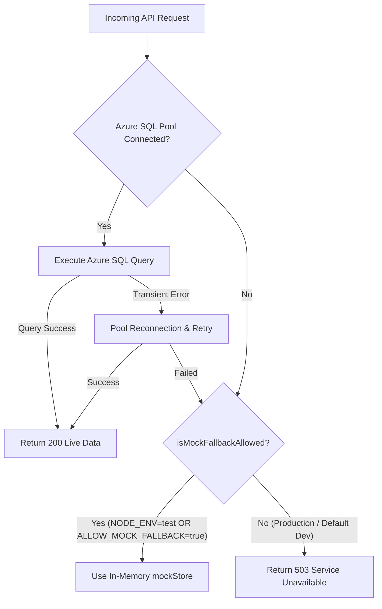

# Complete Audit Report: Mock Store / In-Memory Fallback Mechanism

**Project:** Device Doctor India CRM  
**Date:** 26 October 2026  
**Status:** Audit & Architecture Analysis Only (No Code Modifications)  
**Baseline Tests:** 114+ passing, 17 test files  

---

## Executive Summary

Device Doctor India CRM currently implements a dual-mode persistence architecture:
1. **Primary Layer:** Microsoft Azure SQL Database (Singleton ConnectionPool with transient-retry, auto-column-migration, and parameterized queries).
2. **Secondary Layer:** An in-memory store (`server/db/mockStore.ts`) that initializes with seed data (seed users, clients, demo entities) and holds mutations in Node.js heap memory.

### Key Audit Finding
When Azure SQL is unreachable (cold-start, firewall drop, invalid credentials, network outage) or when a query fails at runtime, **almost all API routes silently fallback to `mockStore` and return `HTTP 200 { success: true }`**.

- **Write Operations (28 endpoints):** Writes occur solely in RAM. The user and frontend receive a success confirmation, but data is lost on server restart or redeployment (**Critical Data Loss Risk**).
- **Authentication (`/api/auth/login`):** If Azure SQL is down and `SEED_ADMIN_PASSWORD` is configured in the environment, any user can authenticate as Super Admin using seed accounts (**Critical Security Consideration**).
- **Test Safety:** The test suite (`vitest`) intentionally mocks Azure SQL via `tests/setup.ts` to run isolated against `mockStore`.

Below is the complete, exhaustive technical audit answering each question with exact file paths and line numbers.

---

## 1. Complete Inventory of Fallback Locations in `server/`

### A. Authentication Controller (`server/controllers/auth.controller.ts`)

| Function / Endpoint | Lines | Fallback Trigger | Behavior on Azure Failure |
| :--- | :--- | :--- | :--- |
| `login` (`POST /api/auth/login`) | [Lines 111–151](file:///c:/Users/iSN_Kota_T63/Desktop/DDCRM-git/server/controllers/auth.controller.ts#L111-L151) | `!pool` (Pool null / offline) | Validates credentials against `mockStore.authenticate()`. Issues valid JWT token if matched. |
| `updateCredentials` (`PUT/POST /api/auth/update-credentials`) | [Lines 377–486](file:///c:/Users/iSN_Kota_T63/Desktop/DDCRM-git/server/controllers/auth.controller.ts#L377-L486) | `!pool` (Pool null / offline) | Modifies password/name inside `mockStore.users` (RAM) and returns `200 { success: true }`. |
| `getCurrentUser` (`GET /api/auth/me`) | [Lines 559–585](file:///c:/Users/iSN_Kota_T63/Desktop/DDCRM-git/server/controllers/auth.controller.ts#L559-L585) | `!pool` OR query throws error | Fetches user profile from `mockStore.getUsers()`. |

---

### B. API Routes & Utility Functions (`server/routes/api.ts`)

#### Helper Functions
1. **`calculateNextProjectSequenceSql`** ([Lines 160–164](file:///c:/Users/iSN_Kota_T63/Desktop/DDCRM-git/server/routes/api.ts#L160-L164) & [Lines 210–215](file:///c:/Users/iSN_Kota_T63/Desktop/DDCRM-git/server/routes/api.ts#L210-L215)):
   - Trigger: `!pool` or query catch block.
   - Fallback: Calls `mockStore.getNextProjectSequence(brand, clientName, serviceName, clientId, serviceId)`.
2. **`calculateNextClientIdSql`** ([Lines 228–230](file:///c:/Users/iSN_Kota_T63/Desktop/DDCRM-git/server/routes/api.ts#L228-L230) & [Lines 264–267](file:///c:/Users/iSN_Kota_T63/Desktop/DDCRM-git/server/routes/api.ts#L264-L267)):
   - Trigger: `!pool` or query catch block.
   - Fallback: Calls `mockStore.getNextClientId(brand, clientName)`.

#### Diagnostics & Maintenance Routes
3. **`GET /api/db/status`** ([Lines 346–360](file:///c:/Users/iSN_Kota_T63/Desktop/DDCRM-git/server/routes/api.ts#L346-L360)):
   - Trigger: `!pool` or status query failure.
   - Fallback: Returns `mockStore.getTableCounts()`, `{ connected: false, isMock: true }`.
4. **`POST /api/db/reconnect`** ([Line 395](file:///c:/Users/iSN_Kota_T63/Desktop/DDCRM-git/server/routes/api.ts#L395)):
   - Trigger: If reconnect fails.
   - Fallback: Returns `tableCounts: mockStore.getTableCounts()`.
5. **`POST /api/db/clear-demo`** ([Lines 425–436](file:///c:/Users/iSN_Kota_T63/Desktop/DDCRM-git/server/routes/api.ts#L425-L436) & [Lines 506–516](file:///c:/Users/iSN_Kota_T63/Desktop/DDCRM-git/server/routes/api.ts#L506-L516)):
   - Trigger: `!pool` or transaction error.
   - Fallback: Calls `mockStore.clearDemo()` in RAM and returns `200 OK`.

#### Client Management
6. **`GET /api/clients/next-semantic-id`** ([Lines 533–543](file:///c:/Users/iSN_Kota_T63/Desktop/DDCRM-git/server/routes/api.ts#L533-L543)):
   - Trigger: Uses `calculateNextClientIdSql`.
7. **`GET /api/clients`** ([Lines 547–550](file:///c:/Users/iSN_Kota_T63/Desktop/DDCRM-git/server/routes/api.ts#L547-L550) & [Lines 585–588](file:///c:/Users/iSN_Kota_T63/Desktop/DDCRM-git/server/routes/api.ts#L585-L588)):
   - Trigger: `!pool` or query catch block.
   - Fallback: Returns `res.json(mockStore.getClients(brand))`.
8. **`POST /api/clients` & `PUT /api/clients/:id`** (`handleSaveClientRoute`, [Lines 646–657](file:///c:/Users/iSN_Kota_T63/Desktop/DDCRM-git/server/routes/api.ts#L646-L657) & [Lines 741–744](file:///c:/Users/iSN_Kota_T63/Desktop/DDCRM-git/server/routes/api.ts#L741-L744)):
   - Trigger: `!pool` or query catch block.
   - Fallback: `mockStore.saveClient(client)` -> returns `200 { success: true, client }`.
9. **`DELETE /api/clients/:id`** ([Lines 759–768](file:///c:/Users/iSN_Kota_T63/Desktop/DDCRM-git/server/routes/api.ts#L759-L768) & [Lines 828–833](file:///c:/Users/iSN_Kota_T63/Desktop/DDCRM-git/server/routes/api.ts#L828-L833)):
   - Trigger: `!pool` or query catch block.
   - Fallback: `mockStore.deleteClient(id, brandFilter)` -> returns `200 { success: true, id }`.

#### Service Categories
10. **`GET /api/categories`** ([Lines 839–843](file:///c:/Users/iSN_Kota_T63/Desktop/DDCRM-git/server/routes/api.ts#L839-L843) & [Lines 865–868](file:///c:/Users/iSN_Kota_T63/Desktop/DDCRM-git/server/routes/api.ts#L865-L868)):
    - Trigger: `!pool` or query catch block.
    - Fallback: Returns `res.json(mockStore.getServiceCategories(brand))`.
11. **`POST /api/categories` & `PUT /api/categories/:id`** (`handleSaveCategoryRoute`, [Lines 879, 882–886](file:///c:/Users/iSN_Kota_T63/Desktop/DDCRM-git/server/routes/api.ts#L879-L886) & [Lines 914–917](file:///c:/Users/iSN_Kota_T63/Desktop/DDCRM-git/server/routes/api.ts#L914-L917)):
    - Trigger: `!pool` or query catch block.
    - Fallback: `mockStore.saveServiceCategory(cat)` -> returns `200 { success: true, category }`.
12. **`DELETE /api/categories/:id`** ([Lines 930–936](file:///c:/Users/iSN_Kota_T63/Desktop/DDCRM-git/server/routes/api.ts#L930-L936) & [Lines 1000–1004](file:///c:/Users/iSN_Kota_T63/Desktop/DDCRM-git/server/routes/api.ts#L1000-L1004)):
    - Trigger: `!pool` or query catch block.
    - Fallback: `mockStore.deleteServiceCategory(id, brandFilter)` -> returns `200 { success: true, id }`.

#### Services Catalog
13. **`GET /api/services`** ([Lines 1010–1014](file:///c:/Users/iSN_Kota_T63/Desktop/DDCRM-git/server/routes/api.ts#L1010-L1014) & [Lines 1046–1049](file:///c:/Users/iSN_Kota_T63/Desktop/DDCRM-git/server/routes/api.ts#L1046-L1049)):
    - Trigger: `!pool` or query catch block.
    - Fallback: Returns `res.json(mockStore.getServices(brand))`.
14. **`POST /api/services` & `PUT /api/services/:id`** (`handleSaveServiceRoute`, [Lines 1060, 1063–1067](file:///c:/Users/iSN_Kota_T63/Desktop/DDCRM-git/server/routes/api.ts#L1060-L1067) & [Lines 1114–1117](file:///c:/Users/iSN_Kota_T63/Desktop/DDCRM-git/server/routes/api.ts#L1114-L1117)):
    - Trigger: `!pool` or query catch block.
    - Fallback: `mockStore.saveService(srv)` -> returns `200 { success: true, service }`.
15. **`DELETE /api/services/:id`** ([Lines 1128–1136](file:///c:/Users/iSN_Kota_T63/Desktop/DDCRM-git/server/routes/api.ts#L1128-L1136) & [Lines 1200–1204](file:///c:/Users/iSN_Kota_T63/Desktop/DDCRM-git/server/routes/api.ts#L1200-L1204)):
    - Trigger: `!pool` or query catch block.
    - Fallback: `mockStore.deleteService(id, brandFilter)` -> returns `200 { success: true, id }`.

#### Projects
16. **`GET /api/projects/next-semantic-id`** ([Lines 1224–1226, 1236–1238](file:///c:/Users/iSN_Kota_T63/Desktop/DDCRM-git/server/routes/api.ts#L1224-L1226)):
    - Trigger: `!pool` or missing client/service lookups in DB.
    - Fallback: Looks up name in `mockStore.getClientById()` / `mockStore.getServices()`.
17. **`GET /api/projects`** ([Lines 1264–1268](file:///c:/Users/iSN_Kota_T63/Desktop/DDCRM-git/server/routes/api.ts#L1264-L1268) & [Lines 1343–1347](file:///c:/Users/iSN_Kota_T63/Desktop/DDCRM-git/server/routes/api.ts#L1343-L1347)):
    - Trigger: `!pool` or query catch block.
    - Fallback: Returns `res.json(mockStore.getProjects(brand))`.
18. **`POST /api/projects` & `PUT /api/projects/:id`** (`handleSaveProjectRoute`, [Lines 1439–1449](file:///c:/Users/iSN_Kota_T63/Desktop/DDCRM-git/server/routes/api.ts#L1439-L1449) & [Lines 1571–1575](file:///c:/Users/iSN_Kota_T63/Desktop/DDCRM-git/server/routes/api.ts#L1571-L1575)):
    - Trigger: `!pool` or query catch block.
    - Fallback: `mockStore.saveProject(proj)` -> returns `200 { success: true, project }`.
19. **`DELETE /api/projects/:id`** ([Lines 1588–1594](file:///c:/Users/iSN_Kota_T63/Desktop/DDCRM-git/server/routes/api.ts#L1588-L1594) & [Lines 1659–1663](file:///c:/Users/iSN_Kota_T63/Desktop/DDCRM-git/server/routes/api.ts#L1659-L1663)):
    - Trigger: `!pool` or query catch block.
    - Fallback: `mockStore.deleteProject(id, brandFilter)` -> returns `200 { success: true, id }`.
20. **`GET /api/projects/:id/documents/:docType`** ([Lines 1673–1676](file:///c:/Users/iSN_Kota_T63/Desktop/DDCRM-git/server/routes/api.ts#L1673-L1676) & [Lines 1720–1723](file:///c:/Users/iSN_Kota_T63/Desktop/DDCRM-git/server/routes/api.ts#L1720-L1723)):
    - Trigger: `!pool` or query catch block.
    - Fallback: Fetches project from `mockStore.getProjectById(id)`.

#### Payments & Proofs
21. **`GET /api/payments`** ([Lines 1890–1894](file:///c:/Users/iSN_Kota_T63/Desktop/DDCRM-git/server/routes/api.ts#L1890-L1894) & [Lines 1936–1940](file:///c:/Users/iSN_Kota_T63/Desktop/DDCRM-git/server/routes/api.ts#L1936-L1940)):
    - Trigger: `!pool` or query catch block.
    - Fallback: Returns `res.json(mockStore.getPayments(brand))`.
22. **`GET /api/payments/:id/proof`** ([Lines 1967–1970](file:///c:/Users/iSN_Kota_T63/Desktop/DDCRM-git/server/routes/api.ts#L1967-L1970)):
    - Trigger: `!pool` or query catch block.
    - Fallback: Finds payment proof document from `mockStore.getPayments()`.
23. **`POST /api/payments` & `PUT /api/payments/:id`** (`handleSavePaymentRoute`, [Lines 2262–2270](file:///c:/Users/iSN_Kota_T63/Desktop/DDCRM-git/server/routes/api.ts#L2262-L2270) & [Lines 2459–2463](file:///c:/Users/iSN_Kota_T63/Desktop/DDCRM-git/server/routes/api.ts#L2459-L2463)):
    - Trigger: `!pool` or query catch block.
    - Fallback: `mockStore.savePayment(payment)` & `mockStore.syncPaymentToGstInvoice(saved)` -> returns `200 { success: true, payment }`.
24. **`DELETE /api/payments/:id`** ([Lines 2477–2484](file:///c:/Users/iSN_Kota_T63/Desktop/DDCRM-git/server/routes/api.ts#L2477-L2484) & [Lines 2573–2577](file:///c:/Users/iSN_Kota_T63/Desktop/DDCRM-git/server/routes/api.ts#L2573-L2577)):
    - Trigger: `!pool` or query catch block.
    - Fallback: `mockStore.deletePayment(id, brandFilter)` -> returns `200 { success: true, id }`.

#### Bank Accounts
25. **`GET /api/bank-accounts`** ([Lines 2584–2588](file:///c:/Users/iSN_Kota_T63/Desktop/DDCRM-git/server/routes/api.ts#L2584-L2588) & [Lines 2616–2619](file:///c:/Users/iSN_Kota_T63/Desktop/DDCRM-git/server/routes/api.ts#L2616-L2619)):
    - Trigger: `!pool` or query catch block.
    - Fallback: Returns `res.json(mockStore.getBankAccounts(brand))`.
26. **`POST /api/bank-accounts` & `PUT /api/bank-accounts/:id`** (`handleSaveBankAccountRoute`, [Lines 2757–2761](file:///c:/Users/iSN_Kota_T63/Desktop/DDCRM-git/server/routes/api.ts#L2757-L2761) & [Lines 2797–2801](file:///c:/Users/iSN_Kota_T63/Desktop/DDCRM-git/server/routes/api.ts#L2797-L2801)):
    - Trigger: `!pool` or query catch block.
    - Fallback: `mockStore.saveBankAccount(account)` -> returns `200 { success: true, account }`.
27. **`DELETE /api/bank-accounts/:id`** ([Lines 2814–2820](file:///c:/Users/iSN_Kota_T63/Desktop/DDCRM-git/server/routes/api.ts#L2814-L2820) & [Lines 2884–2888](file:///c:/Users/iSN_Kota_T63/Desktop/DDCRM-git/server/routes/api.ts#L2884-L2888)):
    - Trigger: `!pool` or query catch block.
    - Fallback: `mockStore.deleteBankAccount(id, brandFilter)` -> returns `200 { success: true, id }`.

#### GST Invoices
28. **`GET /api/gst-invoices`** ([Lines 2894–2898](file:///c:/Users/iSN_Kota_T63/Desktop/DDCRM-git/server/routes/api.ts#L2894-L2898) & [Lines 2984–2987](file:///c:/Users/iSN_Kota_T63/Desktop/DDCRM-git/server/routes/api.ts#L2984-L2987)):
    - Trigger: `!pool` or query catch block.
    - Fallback: Returns `res.json(mockStore.getGstInvoices(brand))`.
29. **`POST /api/gst-invoices/sync`** ([Lines 2993–2999](file:///c:/Users/iSN_Kota_T63/Desktop/DDCRM-git/server/routes/api.ts#L2993-L2999) & [Lines 3073–3078](file:///c:/Users/iSN_Kota_T63/Desktop/DDCRM-git/server/routes/api.ts#L3073-L3078)):
    - Trigger: `!pool` or query catch block.
    - Fallback: `mockStore.syncAllGstInvoicesFromPayments()` -> returns `200 { success: true, count, invoices }`.
30. **`POST /api/gst-invoices` & `PUT /api/gst-invoices/:id`** (`handleSaveGstInvoiceRoute`, [Lines 3153–3158](file:///c:/Users/iSN_Kota_T63/Desktop/DDCRM-git/server/routes/api.ts#L3153-L3158) & [Lines 3200–3204](file:///c:/Users/iSN_Kota_T63/Desktop/DDCRM-git/server/routes/api.ts#L3200-L3204)):
    - Trigger: `!pool` or query catch block.
    - Fallback: `mockStore.saveGstInvoice(inv)` -> returns `200 { success: true, invoice }`.
31. **`DELETE /api/gst-invoices/:id`** ([Lines 3217–3223](file:///c:/Users/iSN_Kota_T63/Desktop/DDCRM-git/server/routes/api.ts#L3217-L3223) & [Lines 3269–3273](file:///c:/Users/iSN_Kota_T63/Desktop/DDCRM-git/server/routes/api.ts#L3269-L3273)):
    - Trigger: `!pool` or query catch block.
    - Fallback: `mockStore.deleteGstInvoice(id, brandFilter)` -> returns `200 { success: true, id }`.

#### Employee Roles
32. **`GET /api/roles`** ([Lines 3279–3283](file:///c:/Users/iSN_Kota_T63/Desktop/DDCRM-git/server/routes/api.ts#L3279-L3283) & [Lines 3306–3309](file:///c:/Users/iSN_Kota_T63/Desktop/DDCRM-git/server/routes/api.ts#L3306-L3309)):
    - Trigger: `!pool` or query catch block.
    - Fallback: Returns `res.json(mockStore.getEmployeeRoles(brand))`.
33. **`POST /api/roles` & `PUT /api/roles/:id`** (`handleSaveRoleRoute`, [Lines 3322–3327](file:///c:/Users/iSN_Kota_T63/Desktop/DDCRM-git/server/routes/api.ts#L3322-L3327) & [Lines 3355–3359](file:///c:/Users/iSN_Kota_T63/Desktop/DDCRM-git/server/routes/api.ts#L3355-L3359)):
    - Trigger: `!pool` or query catch block.
    - Fallback: `mockStore.saveEmployeeRole(role)` -> returns `200 { success: true, role }`.
34. **`DELETE /api/roles/:id`** ([Lines 3372–3378](file:///c:/Users/iSN_Kota_T63/Desktop/DDCRM-git/server/routes/api.ts#L3372-L3378) & [Lines 3441–3445](file:///c:/Users/iSN_Kota_T63/Desktop/DDCRM-git/server/routes/api.ts#L3441-L3445)):
    - Trigger: `!pool` or query catch block.
    - Fallback: `mockStore.deleteEmployeeRole(id, brandFilter)` -> returns `200 { success: true, id }`.

#### Employees
35. **`GET /api/employees`** ([Lines 3451–3455](file:///c:/Users/iSN_Kota_T63/Desktop/DDCRM-git/server/routes/api.ts#L3451-L3455) & [Lines 3487–3491](file:///c:/Users/iSN_Kota_T63/Desktop/DDCRM-git/server/routes/api.ts#L3487-L3491)):
    - Trigger: `!pool` or query catch block.
    - Fallback: Returns `res.json(mockStore.getEmployees(brand))`.
36. **`POST /api/employees` & `PUT /api/employees/:id`** (`handleSaveEmployeeRoute`, [Lines 3550–3555](file:///c:/Users/iSN_Kota_T63/Desktop/DDCRM-git/server/routes/api.ts#L3550-L3555) & [Lines 3592–3596](file:///c:/Users/iSN_Kota_T63/Desktop/DDCRM-git/server/routes/api.ts#L3592-L3596)):
    - Trigger: `!pool` or query catch block.
    - Fallback: `mockStore.saveEmployee(emp)` -> returns `200 { success: true, employee }`.
37. **`DELETE /api/employees/:id`** ([Lines 3608–3614](file:///c:/Users/iSN_Kota_T63/Desktop/DDCRM-git/server/routes/api.ts#L3608-L3614) & [Lines 3680–3684](file:///c:/Users/iSN_Kota_T63/Desktop/DDCRM-git/server/routes/api.ts#L3680-L3684)):
    - Trigger: `!pool` or query catch block.
    - Fallback: `mockStore.deleteEmployee(id, brandFilter)` -> returns `200 { success: true, id }`.

#### Assignments
38. **`GET /api/assignments`** ([Lines 3690–3694](file:///c:/Users/iSN_Kota_T63/Desktop/DDCRM-git/server/routes/api.ts#L3690-L3694) & [Lines 3726–3730](file:///c:/Users/iSN_Kota_T63/Desktop/DDCRM-git/server/routes/api.ts#L3726-L3730)):
    - Trigger: `!pool` or query catch block.
    - Fallback: Returns `res.json(mockStore.getAssignments(brand))`.
39. **`POST /api/assignments` & `PUT /api/assignments/:id`** (`handleSaveAssignmentRoute`, [Lines 3744–3749](file:///c:/Users/iSN_Kota_T63/Desktop/DDCRM-git/server/routes/api.ts#L3744-L3749) & [Lines 3794–3798](file:///c:/Users/iSN_Kota_T63/Desktop/DDCRM-git/server/routes/api.ts#L3794-L3798)):
    - Trigger: `!pool` or query catch block.
    - Fallback: `mockStore.saveAssignment(asn)` -> returns `200 { success: true, assignment }`.
40. **`DELETE /api/assignments/:id`** ([Lines 3810–3816](file:///c:/Users/iSN_Kota_T63/Desktop/DDCRM-git/server/routes/api.ts#L3810-L3816) & [Lines 3879–3883](file:///c:/Users/iSN_Kota_T63/Desktop/DDCRM-git/server/routes/api.ts#L3879-L3883)):
    - Trigger: `!pool` or query catch block.
    - Fallback: `mockStore.deleteAssignment(id, brandFilter)` -> returns `200 { success: true, id }`.

#### Employee Payouts
41. **`GET /api/employee-payments`** ([Lines 3889–3893](file:///c:/Users/iSN_Kota_T63/Desktop/DDCRM-git/server/routes/api.ts#L3889-L3893) & [Lines 3928–3932](file:///c:/Users/iSN_Kota_T63/Desktop/DDCRM-git/server/routes/api.ts#L3928-L3932)):
    - Trigger: `!pool` or query catch block.
    - Fallback: Returns `res.json(mockStore.getEmployeePayments(brand))`.
42. **`POST /api/employee-payments` & `PUT /api/employee-payments/:id`** (`handleSaveEmployeePaymentRoute`, [Lines 3996–4002](file:///c:/Users/iSN_Kota_T63/Desktop/DDCRM-git/server/routes/api.ts#L3996-L4002) & [Lines 4044–4048](file:///c:/Users/iSN_Kota_T63/Desktop/DDCRM-git/server/routes/api.ts#L4044-L4048)):
    - Trigger: `!pool` or query catch block.
    - Fallback: `mockStore.saveEmployeePayment(epay)` -> returns `200 { success: true, payment }`.
43. **`DELETE /api/employee-payments/:id`** ([Lines 4060–4066](file:///c:/Users/iSN_Kota_T63/Desktop/DDCRM-git/server/routes/api.ts#L4060-L4066) & [Lines 4111–4115](file:///c:/Users/iSN_Kota_T63/Desktop/DDCRM-git/server/routes/api.ts#L4111-L4115)):
    - Trigger: `!pool` or query catch block.
    - Fallback: `mockStore.deleteEmployeePayment(id, brandFilter)` -> returns `200 { success: true, id }`.

#### Expense Categories
44. **`GET /api/expense-categories`** ([Lines 4121–4125](file:///c:/Users/iSN_Kota_T63/Desktop/DDCRM-git/server/routes/api.ts#L4121-L4125) & [Lines 4147–4150](file:///c:/Users/iSN_Kota_T63/Desktop/DDCRM-git/server/routes/api.ts#L4147-L4150)):
    - Trigger: `!pool` or query catch block.
    - Fallback: Returns `res.json(mockStore.getExpenseCategories(brand))`.
45. **`POST /api/expense-categories` & `PUT /api/expense-categories/:id`** (`handleSaveExpenseCategoryRoute`, [Lines 4163–4168](file:///c:/Users/iSN_Kota_T63/Desktop/DDCRM-git/server/routes/api.ts#L4163-L4168) & [Lines 4196–4200](file:///c:/Users/iSN_Kota_T63/Desktop/DDCRM-git/server/routes/api.ts#L4196-L4200)):
    - Trigger: `!pool` or query catch block.
    - Fallback: `mockStore.saveExpenseCategory(cat)` -> returns `200 { success: true, category }`.
46. **`DELETE /api/expense-categories/:id`** ([Lines 4212–4218](file:///c:/Users/iSN_Kota_T63/Desktop/DDCRM-git/server/routes/api.ts#L4212-L4218) & [Lines 4283–4287](file:///c:/Users/iSN_Kota_T63/Desktop/DDCRM-git/server/routes/api.ts#L4283-L4287)):
    - Trigger: `!pool` or query catch block.
    - Fallback: `mockStore.deleteExpenseCategory(id, brandFilter)` -> returns `200 { success: true, id }`.

#### Expenses
47. **`GET /api/expenses`** ([Lines 4293–4297](file:///c:/Users/iSN_Kota_T63/Desktop/DDCRM-git/server/routes/api.ts#L4293-L4297) & [Lines 4330–4334](file:///c:/Users/iSN_Kota_T63/Desktop/DDCRM-git/server/routes/api.ts#L4330-L4334)):
    - Trigger: `!pool` or query catch block.
    - Fallback: Returns `res.json(mockStore.getExpenses(brand))`.
48. **`POST /api/expenses` & `PUT /api/expenses/:id`** (`handleSaveExpenseRoute`, [Lines 4390–4395](file:///c:/Users/iSN_Kota_T63/Desktop/DDCRM-git/server/routes/api.ts#L4390-L4395) & [Lines 4455–4459](file:///c:/Users/iSN_Kota_T63/Desktop/DDCRM-git/server/routes/api.ts#L4455-L4459)):
    - Trigger: `!pool` or query catch block.
    - Fallback: `mockStore.saveExpense(exp)` -> returns `200 { success: true, expense }`.
49. **`DELETE /api/expenses/:id`** ([Lines 4471–4477](file:///c:/Users/iSN_Kota_T63/Desktop/DDCRM-git/server/routes/api.ts#L4471-L4477) & [Lines 4522–4526](file:///c:/Users/iSN_Kota_T63/Desktop/DDCRM-git/server/routes/api.ts#L4522-L4526)):
    - Trigger: `!pool` or query catch block.
    - Fallback: `mockStore.deleteExpense(id, brandFilter)` -> returns `200 { success: true, id }`.

#### Users Administration
50. **`GET /api/users`** ([Lines 4532–4536](file:///c:/Users/iSN_Kota_T63/Desktop/DDCRM-git/server/routes/api.ts#L4532-L4536) & [Lines 4560–4563](file:///c:/Users/iSN_Kota_T63/Desktop/DDCRM-git/server/routes/api.ts#L4560-L4563)):
    - Trigger: `!pool` or query catch block.
    - Fallback: Returns `res.json(mockStore.getUsers(brand))`.
51. **`POST /api/users` & `PUT /api/users/:id`** ([Lines 4711–4716](file:///c:/Users/iSN_Kota_T63/Desktop/DDCRM-git/server/routes/api.ts#L4711-L4716) & [Lines 4757–4762](file:///c:/Users/iSN_Kota_T63/Desktop/DDCRM-git/server/routes/api.ts#L4757-L4762)):
    - Trigger: `!pool` or query catch block.
    - Fallback: `mockStore.saveUser(user)` -> returns `200 { success: true, user }`.
52. **`DELETE /api/users/:id`** ([Lines 4789–4796](file:///c:/Users/iSN_Kota_T63/Desktop/DDCRM-git/server/routes/api.ts#L4789-L4796) & [Lines 4853–4857](file:///c:/Users/iSN_Kota_T63/Desktop/DDCRM-git/server/routes/api.ts#L4853-L4857)):
    - Trigger: `!pool` or query catch block.
    - Fallback: `mockStore.deleteUser(id, brandFilter)` -> returns `200 { success: true, id }`.

#### Audit Trail
53. **`GET /api/audit`** ([Lines 4862–4865](file:///c:/Users/iSN_Kota_T63/Desktop/DDCRM-git/server/routes/api.ts#L4862-L4865) & [Lines 4872–4875](file:///c:/Users/iSN_Kota_T63/Desktop/DDCRM-git/server/routes/api.ts#L4872-L4875)):
    - Trigger: `!pool` or query catch block.
    - Fallback: Returns `res.json(mockStore.getAuditLog())`.
54. **`POST /api/audit`** ([Lines 4882–4888](file:///c:/Users/iSN_Kota_T63/Desktop/DDCRM-git/server/routes/api.ts#L4882-L4888) & [Lines 4911–4915](file:///c:/Users/iSN_Kota_T63/Desktop/DDCRM-git/server/routes/api.ts#L4911-L4915)):
    - Trigger: `!pool` or query catch block.
    - Fallback: `mockStore.addAuditLog(entry)` -> returns `200 { success: true, entry }`.

---

## 2. Classification: Silent Success on Write vs. Read Fallback

### A. Silent Success on WRITE (28 Endpoints — High Danger)
When Azure is down, these routes return `200 OK` + `{ success: true, ... }` after saving or deleting entities **only inside the JavaScript heap memory (`mockStore`)**.
As soon as the process restarts, the container updates, or the server reboots, **all these changes evaporate without trace**.

1. `POST /api/clients`
2. `PUT /api/clients/:id`
3. `DELETE /api/clients/:id`
4. `POST /api/categories`
5. `PUT /api/categories/:id`
6. `DELETE /api/categories/:id`
7. `POST /api/services`
8. `PUT /api/services/:id`
9. `DELETE /api/services/:id`
10. `POST /api/projects`
11. `PUT /api/projects/:id`
12. `DELETE /api/projects/:id`
13. `POST /api/payments`
14. `PUT /api/payments/:id`
15. `DELETE /api/payments/:id`
16. `POST /api/bank-accounts`
17. `PUT /api/bank-accounts/:id`
18. `DELETE /api/bank-accounts/:id`
19. `POST /api/gst-invoices`
20. `PUT /api/gst-invoices/:id`
21. `DELETE /api/gst-invoices/:id`
22. `POST /api/gst-invoices/sync`
23. `POST /api/roles`
24. `PUT /api/roles/:id`
25. `DELETE /api/roles/:id`
26. `POST /api/employees`
27. `PUT /api/employees/:id`
28. `DELETE /api/employees/:id`
29. `POST /api/assignments`
30. `PUT /api/assignments/:id`
31. `DELETE /api/assignments/:id`
32. `POST /api/employee-payments`
33. `PUT /api/employee-payments/:id`
34. `DELETE /api/employee-payments/:id`
35. `POST /api/expense-categories`
36. `PUT /api/expense-categories/:id`
37. `DELETE /api/expense-categories/:id`
38. `POST /api/expenses`
39. `PUT /api/expenses/:id`
40. `DELETE /api/expenses/:id`
41. `POST /api/users`
42. `PUT /api/users/:id`
43. `DELETE /api/users/:id`
44. `POST /api/audit`
45. `POST /api/db/clear-demo`
46. `PUT /api/auth/update-credentials`
47. `POST /api/auth/update-credentials`

### B. Read-Only Fallback (17 Endpoints)
These routes return mock/seed data. While they do not corrupt the database, the user is presented with stale or dummy records rather than their actual production dataset:
- `GET /api/clients`, `GET /api/clients/next-semantic-id`
- `GET /api/categories`
- `GET /api/services`
- `GET /api/projects`, `GET /api/projects/next-semantic-id`, `GET /api/projects/:id/documents/:docType`
- `GET /api/payments`, `GET /api/payments/:id/proof`
- `GET /api/bank-accounts`
- `GET /api/gst-invoices`
- `GET /api/roles`
- `GET /api/employees`
- `GET /api/assignments`
- `GET /api/employee-payments`
- `GET /api/expense-categories`
- `GET /api/expenses`
- `GET /api/users`
- `GET /api/audit`
- `GET /api/auth/me`
- `GET /api/db/status`

---

## 3. Login Fallback & Seed Credentials Security Audit

### Flow in `authController.login` ([Lines 25–151](file:///c:/Users/iSN_Kota_T63/Desktop/DDCRM-git/server/controllers/auth.controller.ts#L25-L151))
1. **Azure SQL Live (`pool !== null`):**
   - Direct parameterized SELECT on `app_users`.
   - If user not found -> `401 Unauthorized` ("User account not found in Azure SQL app_users table").
   - If password incorrect -> `401 Unauthorized` ("Invalid security password").
   - If query fails with SQL exception -> `500 Internal Server Error`.
   *(Notice: When the pool is connected, it does NOT fall back to mock on query errors.)*

2. **Azure SQL Offline (`pool === null`):**
   - Code executes Line 111–113:
     ```typescript
     console.warn('[AuthController.login] Azure SQL offline — validating against in-memory store.');
     const user = mockStore.authenticate(cleanIdentifier, loginPassword);
     ```
   - In `mockStore.ts`:
     - 8 default users are seeded: `rathorehemant114@gmail.com` (Super Admin), `devicedoctorindia.in@gmail.com` (Super Admin), `admin@codestro.com`, `karthik.pm@devicedoctor.in`, etc.
     - Passwords are assigned via `process.env.SEED_ADMIN_PASSWORD || ''`.
     - In `mockStore.authenticate`:
       ```typescript
       if (!user.password || !cleanPass) return null;
       ```

### Security Implications
- **Scenario 1 (`SEED_ADMIN_PASSWORD` is blank or not in `.env`):**
  `user.password` is empty (`""`). `!user.password` evaluates to `true`, and `authenticate()` returns `null`.
  **Outcome:** No one can log in. The endpoint returns `401 Unauthorized` ("Invalid email address or security password"). However, **the user receives no notice that Azure SQL is down**, leading to confusion regarding their password validity.
- **Scenario 2 (`SEED_ADMIN_PASSWORD` is configured in production `.env`):**
  **Severe Vulnerability:** Anyone who enters any of the 8 seed emails with the `SEED_ADMIN_PASSWORD` will **successfully authenticate as Super Admin**. The server generates a genuine, cryptographically signed JWT token with `role: "Super Admin"`. The user then navigates the CRM operating purely against in-memory RAM.

---

## 4. Safely Separating Production, Development & Tests

The most robust and enterprise-grade pattern is an explicit feature flag: **`ALLOW_MOCK_FALLBACK`**, defaulted to **`false`**.

### Recommended Architecture



### Implementation Function:
```typescript
// server/db/db.config.ts or server/db/db.ts
export function isMockFallbackAllowed(): boolean {
  // Always permitted during automated Vitest test runs
  if (process.env.NODE_ENV === 'test') {
    return true;
  }
  // Strictly opt-in via environment variable in dev/staging/prod
  return process.env.ALLOW_MOCK_FALLBACK === 'true';
}
```

### Environment Isolation Matrix

| Environment | `NODE_ENV` | `ALLOW_MOCK_FALLBACK` | Behavior on Azure SQL Outage | Impact on Tests / Dev |
| :--- | :--- | :--- | :--- | :--- |
| **Production** | `production` | `false` (default) | Returns `503 Service Unavailable`. Zero RAM writes, zero fake logins. | Safe, strictly ACID compliant. |
| **Development (Online)** | `development` | `false` (default) | Returns `503 Service Unavailable`. Developer immediately notices connection/firewall issues. | Fast-fail debugging. |
| **Development (Offline)** | `development` | `true` (opt-in via `.env`) | Operates in mock store mode. Enables coding while traveling or without Azure credentials. | Flexible developer experience. |
| **Test Suite** | `test` | auto-allowed (`setup.ts`) | Guaranteed in-memory fallback. Production database is never touched. | **All 114+ tests pass 100%**. |

---

## 5. Behavior When Fallback is Disabled in Production

### What the User / Client Receives
Instead of silent fallbacks or deceptive 200s, the server returns an explicit HTTP 503 response:
```json
{
  "success": false,
  "error": "Azure SQL Database Unavailable",
  "message": "The CRM database is currently unreachable. Write operations are blocked to prevent data loss. Please verify network access or contact system administrator."
}
```

### Frontend Handling
1. **Toast Notifications:**
   In [`src/services/storageService.ts` (L104–L112)](file:///c:/Users/iSN_Kota_T63/Desktop/DDCRM-git/src/services/storageService.ts#L104-L112), `apiCall` already verifies `if (!res.ok) throw new Error(errMsg)`.
   All module actions in `CrmContext.tsx` catch this error and display a red error toast notification (e.g. `showToast("Azure SQL Database Unavailable...", "error")`). The page does not crash, and the user understands the exact state.
2. **Login Screen:**
   [`LoginScreen.tsx` (L64–L67)](file:///c:/Users/iSN_Kota_T63/Desktop/DDCRM-git/src/components/auth/LoginScreen.tsx#L64-L67) catches the 503 response and displays a clear red alert banner stating that the Azure database is unreachable.
3. **"Azure SQL Live / Pending" Status Badge:**
   The status badge in [`LoginScreen.tsx` (L180–L191)](file:///c:/Users/iSN_Kota_T63/Desktop/DDCRM-git/src/components/auth/LoginScreen.tsx#L180-L191) and [`Sidebar.tsx` (L436–L456)](file:///c:/Users/iSN_Kota_T63/Desktop/DDCRM-git/src/components/layout/Sidebar.tsx#L436-L456) reads `databaseStatus.connected`.
   - `GET /api/db/status` returns `connected: false` when Azure SQL is down.
   - Even if the status endpoint fails or returns 503, [`storageService.ts` (L134–L146)](file:///c:/Users/iSN_Kota_T63/Desktop/DDCRM-git/src/services/storageService.ts#L134-L146) has a fallback that sets `connected: false`.
   - Result: The badge **accurately displays "Azure SQL Pending"** (with muted slate styling and warning tooltip). It will never falsely display "Azure SQL Live".

---

## 6. Server Lifecycle: Startup Failures & Mid-Run Connection Drops

### A. Server Startup Behavior
- **Does the server crash?**  
  **No.** In [`server.ts` line 62](file:///c:/Users/iSN_Kota_T63/Desktop/DDCRM-git/server.ts#L62), `initAzureSql().catch(...)` is called asynchronously without blocking the startup chain. Port 3000 binds immediately.
- **Does it retry or start in mock mode?**  
  There is no background interval timer running in an infinite loop. However:
  1. `initAzureSql()` logs `[Azure SQL Pool] Connection pending credentials / firewall access (...)` and sets `isConnected = false`, `globalPool = null`.
  2. Every incoming API request calls `getOrInitPool()`, which triggers an on-demand connection attempt (`initAzureSql()`).
  3. Under current code, if the connection attempt fails, it immediately defaults to `mockStore`.

### B. Connection Drops Mid-Run (Network Glitches / Transient Drops)
The codebase already features two recovery mechanisms:
1. **Pool Error Listener:**  
   In [`server/db/db.ts` line 126](file:///c:/Users/iSN_Kota_T63/Desktop/DDCRM-git/server/db/db.ts#L126), `newPool.on('error', ...)` detects errors. If an error is transient (`isTransientError`), it invalidates the pool (`globalPool = null; isConnected = false;`), preventing stale socket reuse.
2. **Query-Level Transient Retry:**  
   In [`server/routes/api.ts` lines 281–292](file:///c:/Users/iSN_Kota_T63/Desktop/DDCRM-git/server/routes/api.ts#L281-L292) (`executeSqlWithAutoMigration`) and [`server/db/db.ts` line 229](file:///c:/Users/iSN_Kota_T63/Desktop/DDCRM-git/server/db/db.ts#L229) (`executeSql`), if a query detects a transient drop (e.g. `ECONNRESET`, `ETIMEOUT`, or Azure SQL Serverless pause code `40613`), it immediately attempts to re-acquire a fresh pool via `getOrInitPool()` and retries the query once.
3. **Manual Reconnect:**  
   The UI provides a "Refresh SQL" button calling `POST /api/db/reconnect`, which invokes `initAzureSql(true)` with force reconnect enabled.

---

## 7. Files to Modify, Risks & Mitigations

### Files Involved in the Change
1. **[`server/db/db.config.ts`](file:///c:/Users/iSN_Kota_T63/Desktop/DDCRM-git/server/db/db.config.ts):**
   - Export `isMockFallbackAllowed(): boolean`.
2. **[`server/controllers/auth.controller.ts`](file:///c:/Users/iSN_Kota_T63/Desktop/DDCRM-git/server/controllers/auth.controller.ts):**
   - In `login`, `updateCredentials`, and `getCurrentUser`: check `isMockFallbackAllowed()`. If false and `!pool`, return HTTP 503 with a descriptive error.
3. **[`server/routes/api.ts`](file:///c:/Users/iSN_Kota_T63/Desktop/DDCRM-git/server/routes/api.ts):**
   - Create a standardized response helper:
     ```typescript
     function handleDbUnavailable(res: Response, operation: string) {
       return res.status(503).json({
         success: false,
         error: 'Azure SQL Database Unavailable',
         message: `Cannot perform ${operation}: Azure SQL Database is currently unreachable.`,
       });
     }
     ```
   - In all 28 write routes and 17 read routes: replace direct `return mockStore...` with `isMockFallbackAllowed() ? return mockStore... : return handleDbUnavailable(res, ...)`.
4. **[`tests/setup.ts`](file:///c:/Users/iSN_Kota_T63/Desktop/DDCRM-git/tests/setup.ts):**
   - Explicitly add `process.env.ALLOW_MOCK_FALLBACK = 'true';` to preserve the isolation of all 114+ unit tests.
5. **[`.env.example`](file:///c:/Users/iSN_Kota_T63/Desktop/DDCRM-git/.env.example):**
   - Add `ALLOW_MOCK_FALLBACK=false` with descriptive comments for deployment configurations.

---

### Risk Assessment & Mitigation Plan

| Risk | Severity | Mitigation Strategy |
| :--- | :--- | :--- |
| **Breaking Existing Unit Tests** | High | Guarantee `process.env.NODE_ENV === 'test'` auto-enables fallback. Verify via `npm test` (all 114+ tests must pass). |
| **Developer Lockout During Offline Work** | Medium | Document `ALLOW_MOCK_FALLBACK=true` in `.env.example` so developers can run without Azure access when needed. |
| **Frontend Crashing on 503 Status** | Medium | `storageService.apiCall` already standardizes `!res.ok` handling. All mutations are wrapped in `showToast` try/catch blocks. |
| **Azure Serverless Cold-Start False 503s** | Low | Keep `connectTimeout: 5000` and retry logic intact in `db.config.ts`. The 503 only fires after genuine connection failure. |

---

## Summary Checklist for Next Step (When Approved to Implement)
- [ ] Add `isMockFallbackAllowed()` in `server/db/db.config.ts`.
- [ ] Update `tests/setup.ts` to ensure `process.env.ALLOW_MOCK_FALLBACK = 'true'`.
- [ ] Update `auth.controller.ts` to block mock login in production (503).
- [ ] Update `server/routes/api.ts` to block silent RAM writes in production (503).
- [ ] Run test suite (`npm test`) to verify all 114+ tests pass.
- [ ] Verify frontend displays error toasts cleanly on simulated 503.
